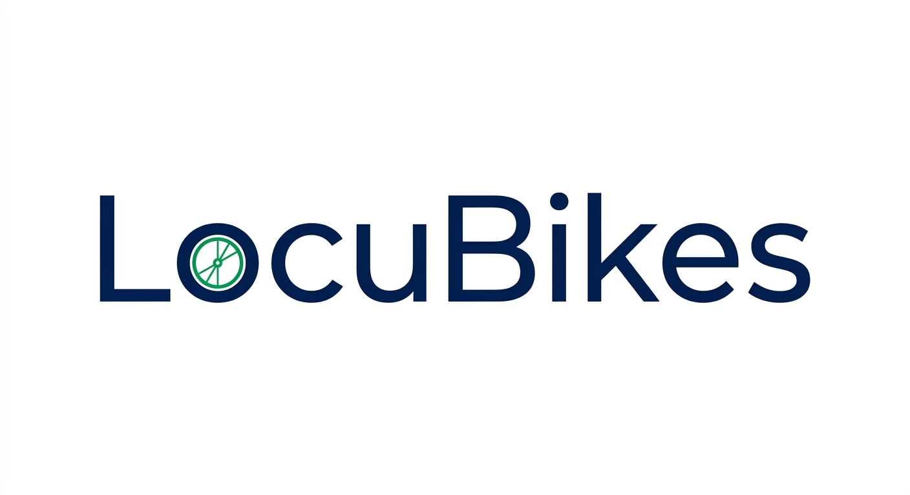
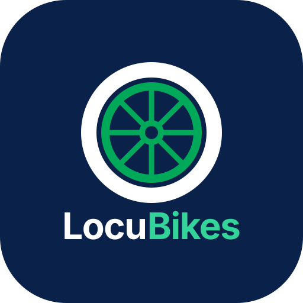

<div align="center">
  

  <h1>LocuBikes — Mobilidade Urbana &amp; Gestão de Frotas</h1>

  <p>
    Aplicação web progressiva (<strong>PWA instalável</strong>) minimalista e full-stack para aluguel de bicicletas, desbloqueio por QR Code, mapa interativo em tempo real, carteira digital com simulação completa de <strong>NuPay (Nubank)</strong> e painel corporativo restrito para gestão de frota e recebimentos.
  </p>

  <p>
    
    
    
    
    
    
  </p>
</div>

---

## Sumário

- [Visão Geral e Funcionalidades](#-visão-geral-e-funcionalidades)
- [Design System e Identidade Visual](#-design-system-e-identidade-visual)
- [PWA — Instalação como Web App](#-pwa--instalação-como-web-app)
- [Arquitetura e Estrutura de Pastas](#-arquitetura-e-estrutura-de-pastas)
- [Execução Local e Testes](#-execução-local-e-testes)
- [Hospedagem e Deploy em Produção](#-hospedagem-e-deploy-em-produção)
- [Acesso Corporativo (Demonstração)](#-acesso-corporativo-demonstração)

---

## Visão Geral e Funcionalidades

A **LocuBikes** separa de forma objetiva a experiência pública do **Cliente** da operação privada da **Empresa**:

### 1. Visão do Cliente (App Mobile & Web App)
- **Mapa Interativo com Geolocalização**: Mostra estações próximas em tempo real ordenadas por distância (cálculo Haversine), filtros por categoria (`Todas`, `Urbana`, `Elétrica`, `Gravel`, `Estrada`), alternância de pontos GPS de referência e seleção direta de bicicletas.
- **Desbloqueio por QR Code**: Leitura/entrada rápida de código da bicicleta (`LOC-01`, tokens ou URLs) com estimativa tarifária por minuto ou cobertura automática por assinatura mensal.
- **Pagamento Integrado**:
  - **NuPay (Nubank)**: Fluxo completo simulado nas cores oficiais Nubank (`#820AD1`), escolha entre **Saldo da conta Nubank** (débito instantâneo) ou **Cartão de crédito Nubank (NuPay)** (parcelamento de `1x` a `12x`, até `6x` sem juros), autorização por **Biometria Nu** ou **Senha de 4 dígitos** e comprovante `NUPAY-XXXXXXNU`.
  - **PIX Copia e Cola**: QR Code e payload determinístico com desconto à vista nas reservas por hora/diária.
  - **Carteira Digital & Cartões**: Recarga de saldo, cadastro/remoção de cartões e contratação/cancelamento de passes mensais.
- **Histórico de Corridas & Gamificação**: Registro completo de corridas concluídas com tempo, distância percorrida, valor pago, calorias gastas (`kcal`), economia de `CO₂` e evolução do nível de ciclista.
- **Carrossel de Aplicativos de Entrega em Movimento**: Faixa contínua em movimento destacando plataformas compatíveis com entregas por bike (**iFood Entregador**, **Rappi Entregador**, **Uber Direct & Eats**, **Lalamove Bike**, **Loggi Última Milha**, **Zé Delivery** e **99Entrega Bike**) com logos oficiais, recomendações de modelo e filtro rápido para o catálogo.
- **Bicicleta Flutuante Interativa**: Elemento em PNG transparente sobreposto ao aplicativo com flutuação suave, sombreamento e suporte completo a arrastar por toque (dedo) ou mouse — revelando um **X temporário** na base da tela caso o usuário queira removê-la ou apenas reposicioná-la.

### 2. Visão da Empresa (Acesso Restrito)
- **Login no Rodapé**: Botão `Entrar pela empresa` no rodapé da aplicação abrindo modal autenticado por e-mail e senha com sessão por token Bearer.
- **Gestão da Frota**: Cadastro de novos modelos, atualização de especificações, tarifas por hora/diária/minuto, nível de bateria, alternância de disponibilidade (`Disponível`, `Alugada`, `Manutenção`) e exclusão de unidades.
- **Locações e Pagamentos**: Acompanhamento de reservas, encerramento/devolução de locações e livro-caixa financeiro filtrado por método (`NuPay`, `PIX`, `Cartão`, `Carteira`).

---

## Design System e Identidade Visual

| Elemento | Especificação |
| --- | --- |
| **Ícone do Web App** |  Marca `LocuBikes` em azul-marinho (`#0A224A`) com roda raiada esmeralda (`#00A859`) |
| **Tipografia** | `Outfit` (títulos e display), `Plus Jakarta Sans` (interface e leitura), `JetBrains Mono` (códigos, valores tabulares e comprovantes) |
| **Modo Claro** | Superfície base `#FAFAFA`, cards `#FFFFFF`, texto principal `#09090B`, bordas sutis `#E4E4E7` |
| **Modo Escuro** | Superfície base `#09090B`, cards `#18181B`, acento de foco `#34D399` (esmeralda), logo adaptada automaticamente |
| **NuPay Accent** | Roxo assinatura `#820AD1`, hover `#6D08B0`, superfícies escuras `#140722` / `#190A2B` |
| **Efeitos & Profundidade** | Desfoque translúcido (`backdrop-filter: blur(8px)`) na barra fixa superior e fundos de modais, halos radiais sutis de fundo, elevação em camadas (`.card-elevated` / `.card-lift`) e animações compositor-only respeitando `prefers-reduced-motion` |

---

## PWA — Instalação como Web App

A aplicação está configurada com `vite-plugin-pwa` e **Workbox** para instalação nativa em **Android**, **iOS (Safari)** e **Desktop (Chrome/Edge)**:

- **Manifesto Web App** gerado em `/manifest.webmanifest` (`display: standalone`, `start_url: /`, `scope: /`, `theme_color: #0A224A`).
- **Ícones dedicados** em `public/`:
  - `public/icon.svg` — Ícone vetorial para abas de navegador.
  - `public/pwa-192x192.png` e `public/pwa-512x512.png` — Ícones padrão (`purpose: "any"`).
  - `public/pwa-maskable-512x512.png` — Ícone adaptável Android com margem de segurança (`purpose: "maskable"`).
  - `public/apple-touch-icon.png` — Ícone `180x180` para tela inicial do iOS Safari.
- **Service Worker & Cache Offline**:
  - Pré-cache dos assets estáticos da aplicação.
  - Estratégia `NetworkFirst` em `/api/public/state` para consulta de bicicletas e estações mesmo com conexão instável.
  - Rotas `/api/*` excluídas do fallback de navegação SPA (`navigateFallbackDenylist`).
- **Botão de Instalação In-App**: Exibido automaticamente no cabeçalho quando o navegador habilita instalação (`beforeinstallprompt`) ou oferece guia passo a passo no iOS Safari, ocultando-se quando já aberto em modo `standalone`.

---

## Arquitetura e Estrutura de Pastas

```text
locubikes/
├── public/
│   ├── assets/aistudio/          # Logo LocuBikes, logos dos apps de entrega e bike PNG transparente
│   ├── apple-touch-icon.png      # Ícone iOS 180x180
│   ├── icon.svg                  # Ícone vetorial da marca
│   ├── pwa-192x192.png           # Ícone PWA 192x192
│   ├── pwa-512x512.png           # Ícone PWA 512x512
│   └── pwa-maskable-512x512.png  # Ícone adaptável Android com safe zone
├── server/
│   └── store.ts                  # Persistência JSON em arquivo, regras de negócio e autenticação
├── server.ts                     # Servidor Express (API REST + Vite dev middleware / static dist)
├── src/
│   ├── api/client.ts             # Cliente HTTP tipado para rotas públicas e autenticadas
│   ├── components/               # Componentes modulares (Mapa, QR, Carteira, NuPay, Frota, PWA)
│   ├── hooks/usePWAInstall.ts    # Hook de instalação PWA (Android/Desktop/iOS)
│   ├── types/bike.ts             # Tipos compartilhados TypeScript
│   ├── utils/                    # Funções puras de precificação, mobilidade e suítes node:test
│   ├── App.tsx                   # Orquestração de estado e navegação Cliente/Empresa
│   ├── index.css                 # Tailwind v4 + animações marquee/flutuação + sombras/glass
│   └── main.tsx                  # Registro do Service Worker e bootstrap React
├── Dockerfile                    # Imagem multi-stage de produção (Node 22 Alpine)
├── fly.toml                      # Configuração Fly.io (região gru + volume persistente)
├── railway.json                  # Configuração Railway (Dockerfile + healthcheck)
├── render.yaml                   # Blueprint Render Web Service
├── Procfile                      # Comando web padrão PaaS
├── index.html                    # Metadados SEO, tema inicial e tags PWA/iOS
└── vite.config.ts                # Configuração Vite + Tailwind + VitePWA
```

---

## Execução Local e Testes

### Pré-requisitos
- **Node.js 20+** (recomendado **Node 22**)
- **npm 10+**

### Passos

```bash
# 1. Instalar dependências
npm install

# 2. (Opcional) Configurar variáveis de ambiente
cp .env.example .env

# 3. Iniciar ambiente de desenvolvimento full-stack (Express + Vite na porta 3000)
npm run dev
```

Acesse `http://localhost:3000`.

### Scripts Disponíveis

| Comando | Descrição |
| --- | --- |
| `npm run dev` | Sobe API Express + frontend Vite com PWA ativo em `http://localhost:3000` |
| `npm run build` | Gera o bundle de produção em `dist/` (incluindo `manifest.webmanifest` e `sw.js`) |
| `npm start` | Executa o servidor Express em modo produção servindo `dist/` e `/api/*` |
| `npm run lint` | Executa verificação estrita TypeScript (`tsc --noEmit`) |
| `npx tsx --test src/utils/pricing.test.ts src/utils/mobility.test.ts` | Executa a suíte de testes unitários de precificação, NuPay e mobilidade |

---

## Hospedagem e Deploy em Produção

Como a **LocuBikes** possui backend Express (`/api/*` + persistência em `data/locubikes-db.json`) e frontend PWA compilado em `dist/`, o repositório já inclui arquivos prontos para os principais provedores:

### 1. Docker / Google Cloud Run / VPS
```bash
# Build da imagem de produção
docker build -t locubikes .

# Execução local do container com volume persistente
docker run -p 3000:3000 -v locubikes_data:/app/data locubikes
```
Para **Google Cloud Run**:
```bash
gcloud run deploy locubikes \
  --source . \
  --port 3000 \
  --allow-unauthenticated
```

### 2. Render (`render.yaml`)
1. Conecte o repositório no painel do **Render** como **Blueprint** ou **Web Service**.
2. O arquivo `render.yaml` já define `npm install && npm run build`, `npm start` e healthcheck em `/api/health`.

### 3. Railway (`railway.json`)
1. Crie um novo projeto a partir do repositório GitHub no **Railway**.
2. O arquivo `railway.json` utiliza automaticamente o `Dockerfile` multi-stage e monitora `/api/health`.

### 4. Fly.io (`fly.toml`)
```bash
fly launch --copy-config
fly volumes create locubikes_data --region gru --size 1
fly deploy
```
Configurado para a região de **São Paulo (`gru`)** com HTTPS obrigatório e volume persistente para `/app/data`.

### Variáveis de Ambiente Suportadas

| Variável | Obrigatória | Padrão | Descrição |
| --- | --- | --- | --- |
| `PORT` | Não | `3000` | Porta HTTP escutada pelo servidor Express |
| `NODE_ENV` | Produção | `production` | Ativa serviço estático de `dist/` com cabeçalhos PWA |
| `COMPANY_ADMIN_EMAIL` | Não | `admin@locubikes.com.br` | E-mail de acesso ao painel da empresa |
| `COMPANY_ADMIN_PASSWORD` | Não | `locubikes2026` | Senha de acesso ao painel da empresa |
| `GEMINI_API_KEY` | Opcional | — | Chave de API definida em `.env.example` |
| `APP_URL` | Opcional | — | URL pública da aplicação hospedada |

---

## Acesso Corporativo (Demonstração)

Para testar o painel administrativo da empresa, clique em **`Entrar pela empresa`** no rodapé da aplicação:

- **E-mail**: `admin@locubikes.com.br`
- **Senha**: `locubikes2026`
